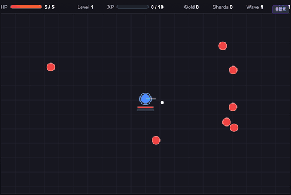

# One Room Roguelike

**한 방에서 몰려오는 적을 버티며 보상·아이템·융합탄으로 빌드를 만드는 브라우저 로그라이크.**

**[▶ 브라우저에서 바로 플레이](https://tinkerer0.github.io/game/)**



적을 잡아 레벨이 오르면 보상 카드 3장 중 하나를 고릅니다. 골드로 아이템을 사서 같은 종류를 모으면 세트 효과가 생기고, 탄을 조합하면 융합탄이 됩니다(게임 안의 **융합표**에서 확인). 5웨이브마다 중간 보스, 10웨이브마다 보스가 나옵니다. Shards를 모아 새 캐릭터를 엽니다.

WASD로 움직이고 방향키로 공격합니다.

## 직접 실행

빌드가 필요 없는 정적 파일(`index.html`, `game.js`, `styles.css`)입니다.

```sh
git clone https://github.com/tinkerer0/game.git
cd game
python3 -m http.server 8000   # http://localhost:8000 열기
```

캐릭터 해금 정보는 이 브라우저(`localStorage`)에만 저장됩니다. 밸런스 목표와 알려진 한계는 [DESIGN_GOALS.md](DESIGN_GOALS.md)에 있습니다.

## Feedback

제가 이런 분야를 접한 지 얼마 안 돼서 부족한 점이 많습니다. 고칠 점이나 알려주실 내용이 있다면 issue나 PR로 남겨주시면 너무 감사하겠습니다.

I am still new to this, so there is a lot to improve. Issues and pull requests with fixes or suggestions are very welcome.

## License

[MIT](LICENSE)
